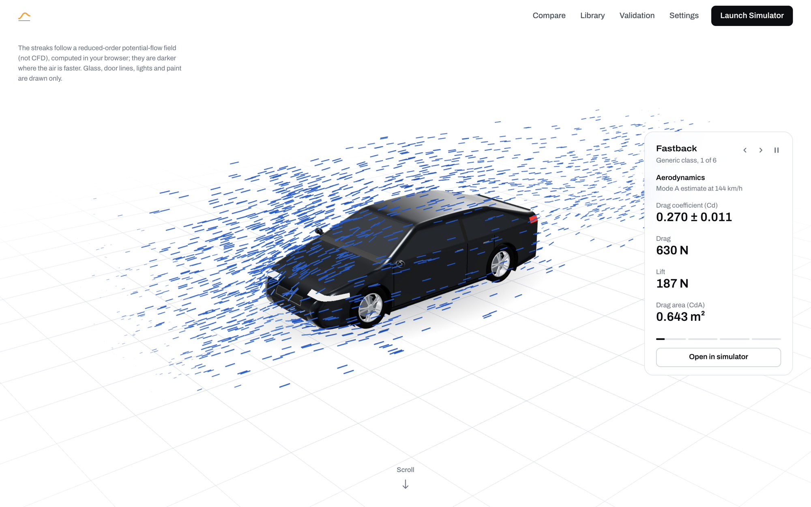
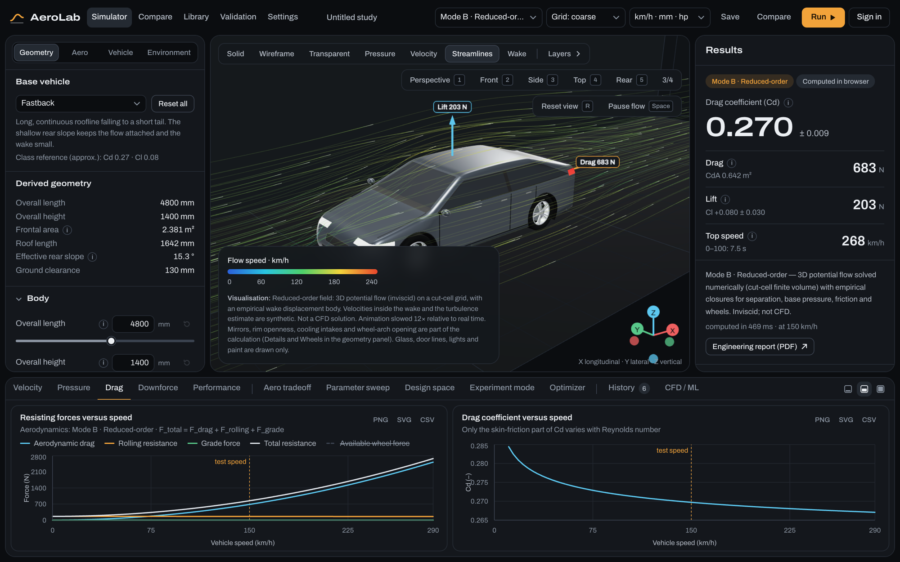
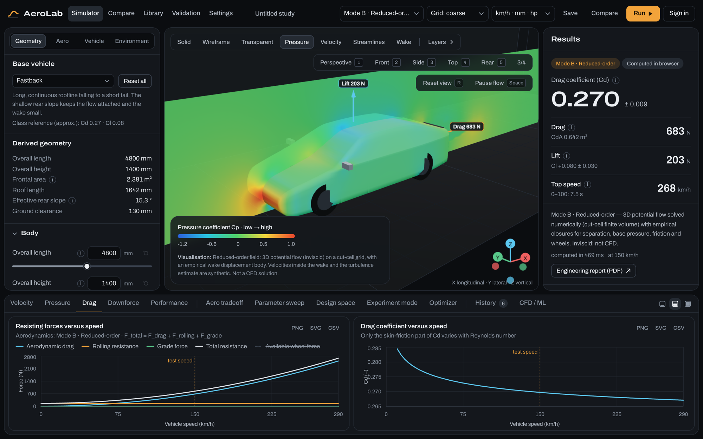
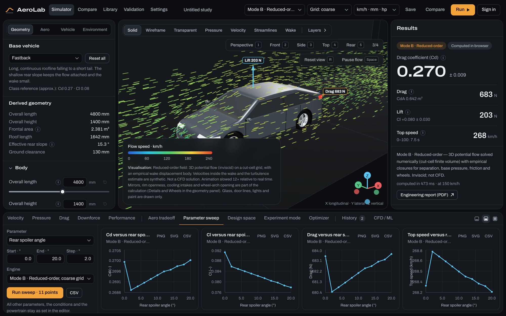
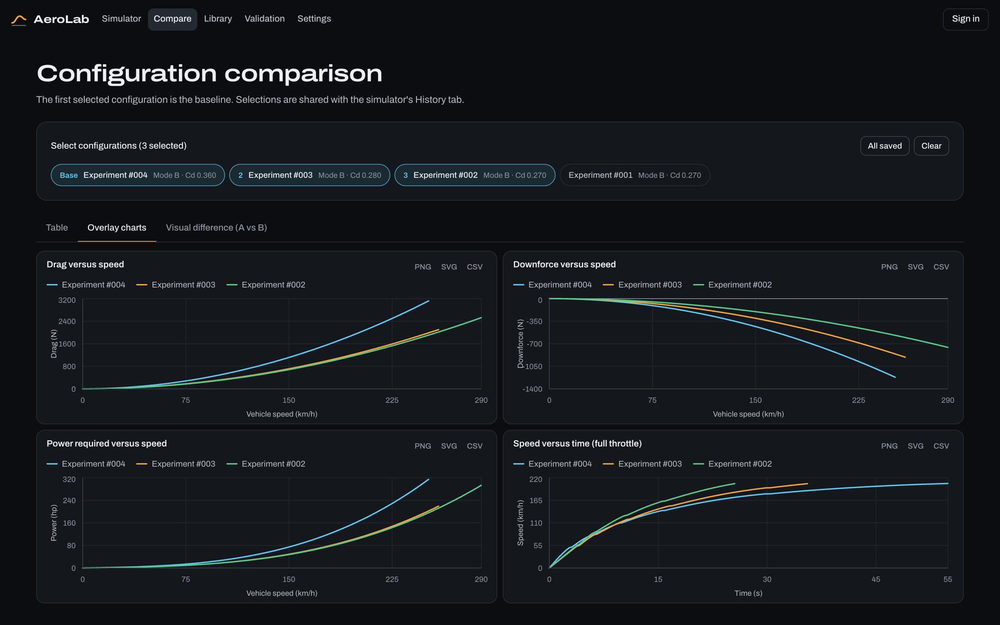
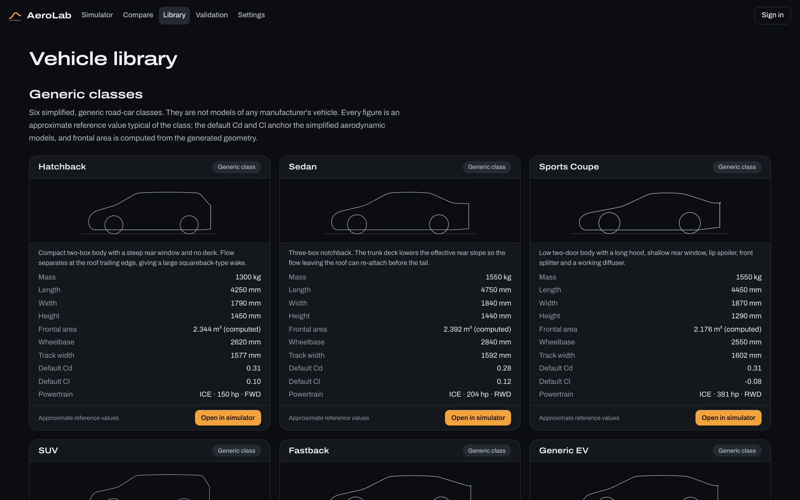

# AeroLab — Virtual Wind Tunnel & Vehicle Performance Simulator

AeroLab is an interactive, browser-based wind tunnel for simplified road-car shapes. You pick a generic
vehicle class, reshape it with engineering parameters, run a simulation, look at the airflow, and see how
the aerodynamic forces change acceleration, top speed and power demand.

**Live:** <https://aerolab-web.fly.dev>



> **AeroLab is an educational and research-oriented tool. It does not replace professional CFD or
> wind-tunnel testing.** Its numbers are estimates from simplified models with stated assumptions and an
> explicit uncertainty. They are most trustworthy as *differences between two configurations run with the
> same model*, not as absolute values for a real vehicle.

## Contents

1. [Screenshots](#screenshots)
2. [Overview](#overview)
3. [Architecture](#architecture)
4. [Installation](#installation)
5. [Running locally](#running-locally)
6. [Deployment (Fly.io)](#deployment-flyio)
7. [Frontend](#frontend)
8. [Backend](#backend)
9. [Physics equations](#physics-equations)
10. [Assumptions](#assumptions)
11. [Production cars and validation](#production-cars-and-validation)
12. [Imported 3D models](#imported-3d-models)
13. [CFD integration](#cfd-integration)
14. [ML surrogate](#ml-surrogate)
15. [Optimization](#optimization)
16. [Testing](#testing)
17. [Limitations](#limitations)
18. [Future work](#future-work)

## Screenshots

**The simulator.** A Mode B (reduced-order) run of the Fastback: streamlines around the car, forces on it,
the result with its uncertainty, and resisting force and Cd against speed.



| | |
| --- | --- |
|  |  |
| **Pressure.** The pressure coefficient on the body and in the symmetry plane: stagnation at the nose, suction over the roof. | **Parameter sweep.** Cd, Cl, drag and top speed as the rear spoiler angle goes from 0° to 20°. |
|  |  |
| **Compare.** Three configurations side by side: drag, downforce, power required and acceleration. | **Validation.** Predicted against published Cd for 17 production-car look-alikes, with the error statistics. |



**Library.** The six generic vehicle classes (and 17 production-car look-alikes further down), each with
its reference values, ready to open in the simulator.

Taken on 28 October 2026 from the same code as the live site, in a 1440 × 900 window; everything shown was
computed in the browser (Mode B, coarse grid, 150 km/h).

## Overview

The simulator connects five things in one loop:

```
Geometry  →  Airflow  →  Aerodynamic forces  →  Vehicle dynamics  →  Performance
```

**What you can do**

- Start from one of six generic classes (hatchback, sedan, sports coupe, SUV, fastback, generic EV), or
  from one of 17 production cars rebuilt as parametric look-alikes, and change 34 geometry parameters.
  The 3D model is built from the parameters, so every slider visibly changes the car.
- See how the models' predictions for those 17 cars compare with the published drag coefficients.
- Run the aerodynamics in one of four clearly separated modes (below) at any speed, air state, crosswind
  and road gradient.
- Visualise the flow: animated particles, animated streamlines, velocity and pressure slices, surface pressure,
  wake and separation region, force vectors.
- Read drag, lift/downforce, front/rear balance, side force and yaw moment, each with an uncertainty.
- Turn those forces into acceleration times, top speed, power demand, maximum gradient and (for the EV)
  range, with an ICE or EV powertrain and a traction limit.
- Compare configurations, sweep one parameter, map two parameters, run a guided "what happens if…"
  experiment, or search for a design that meets targets.
- Export JSON, CSV, PNG and SVG, and print an engineering report to PDF.

**The four simulation modes — never blurred**

| Mode | Name | What it is | Runs in |
| --- | --- | --- | --- |
| A | Analytical | Semi-empirical component build-up (closed-form correlations). No flow is solved. | Browser and backend |
| B | Reduced-order | 3D incompressible potential flow solved on a cut-cell grid, plus empirical closures for separation, base pressure, friction and wheels. Inviscid. **Not CFD.** | Browser and backend |
| C | CFD | Adapter for OpenFOAM (RANS). Runs only where OpenFOAM is installed. | Backend |
| D | ML surrogate | Regression model trained on results from Mode A or B. A statistical prediction, not a physical simulation. | Backend |

Every result, chart, sweep, report and history entry states which mode produced it. A mode that cannot
run fails with an explicit error; no engine ever returns substitute numbers. The flow *visualisation* is
always the Mode B potential-flow field and is labelled as such, whichever mode produced the coefficients.

**Without the backend** the app runs fully in the browser with Modes A and B and shows
`DEMO / ANALYTICAL MODE` in the header.

## Architecture

```
┌───────────────────────────── Browser ─────────────────────────────┐
│ Next.js App Router · React · TypeScript · Tailwind                │
│                                                                   │
│  UI (components/)        State (lib/state, zustand)               │
│   controls · 3D · charts   session · experiments · view           │
│          │                        │                               │
│          └──────────┬─────────────┘                               │
│                     ▼                                             │
│  Web Worker (lib/simulation/worker.ts)                            │
│   Mode A engine · Mode B solver · sweep · optimiser · performance │
└─────────────────────┬─────────────────────────────────────────────┘
                      │ HTTP/JSON (optional)
┌─────────────────────▼──────────── Python backend ─────────────────┐
│ FastAPI · NumPy · SciPy · pandas · scikit-learn · Pydantic        │
│                                                                   │
│  SimulationEngine                                                 │
│   ├── AnalyticalEngine      Mode A                                │
│   ├── ReducedOrderEngine    Mode B                                │
│   ├── OpenFOAMEngine        Mode C  (implements CFDBackend)       │
│   └── MLSurrogateEngine     Mode D                                │
│  Job system · result cache · sweeps · optimisation                │
└───────────────────────────────────────────────────────────────────┘
```

**One model, two implementations.** The physics exists in TypeScript (so the app works with no backend
and stays responsive) and in Python (for the API, the surrogate and the optimisers). They are kept
identical by construction:

- `shared/parameters.json`, `shared/vehicles.json` and `shared/aero-model.json` hold every parameter
  range, vehicle definition and model constant. Both languages read these files; neither hard-codes a
  coefficient.
- `npm run golden` evaluates a fixed set of cases with the TypeScript engines and writes them to
  `shared/golden/`. `backend/tests/test_parity.py` recomputes every case in Python and requires
  agreement. `tests/golden.test.ts` fails if the stored files are stale.

**Repository layout**

```
app/                 Pages: / · /simulator · /compare · /library · /import · /validation · /settings · /report
components/
  3d/                Vehicle mesh, car detail (paint shader, wheels, mirrors), painted imported model,
                     tunnel, particles, streamlines, slices, wake, force vectors
  charts/            Line charts, heatmap, print charts
  controls/          Geometry, vehicle and environment panels
  dashboard/         Results, comparison, library, settings, report
  import/            3D-model import page and its preview
  simulator/         Workspace, viewport, run controls, analysis dock
  ui/                Buttons, fields, tabs, tooltips, header
lib/
  geometry/          Parametric profile, mesh, solids, metrics, validation; measuring imported models
  import/            Reading model files (glTF, OBJ, STL, zip) and storing them in the browser
  physics/           Forces, atmosphere, wind, rear-flow closure, analytical aerodynamics
  simulation/        Engines, potential-flow solver, sweep, optimiser, worker, backend client
  vehicle/           Powertrain and performance (acceleration, top speed, grade)
  state/             Stores and run orchestration
  utils/             Units, export, colour maps, glossary
shared/              Parameters, vehicles, production-car look-alikes, model constants, golden files
                     (read by both languages)
tests/               Frontend unit tests (Vitest)
backend/
  api/               HTTP routes
  engines/           The four engines and the engine registry
  geometry/ physics/ vehicle/ simulation/ optimization/   Python mirror of lib/
  models/            Pydantic request models
  tests/             Backend tests (pytest)
```

**Coordinate system.** X is longitudinal (flow direction, nose at x = 0), Y lateral, Z vertical with the
road at z = 0. The same convention is used in the geometry kernel, the solver, the 3D scene and the
OpenFOAM case.

## Installation

Requirements: Node.js 20 or newer, and for the backend Python 3.11 or newer with
[uv](https://docs.astral.sh/uv/).

```bash
npm install
```

```bash
cd backend && uv sync
```

The backend is optional. OpenFOAM is optional and only needed to *run* Mode C. On macOS the native
build installs with `brew install gerlero/openfoam/openfoam` (a community build of OpenFOAM v2606 that
is not notarised by Apple); on Linux use the openfoam.com packages.

## Running locally

Frontend, at <http://localhost:3000>:

```bash
npm run dev
```

Backend, at <http://localhost:8000> (interactive API docs at `/docs`):

```bash
npm run backend
```

The header shows `BACKEND ONLINE` once the frontend reaches the backend. The backend address can be
changed under Settings. Running anything on the backend needs an account: **Sign in** in the header
creates one in the local database. Everything computed in the browser works without one.

Production build:

```bash
npm run build
```

```bash
npm run start
```

**The 60-second experiment.** Open the simulator, keep the Fastback at 150 km/h, press **Run**. Set
*Ride height* to 70 mm, press **Run** again, then **Compare**. You get the change in Cd, lift, drag,
top speed and power, with a note on the tradeoff.

## Deployment (Fly.io)

Two Fly apps, both built from the repository root:

| App | Files | Machine | What it is |
| --- | --- | --- | --- |
| `aerolab-web` | `deploy/frontend/` | `shared-cpu-1x`, 1 GB | The Next.js app, public at `https://aerolab-web.fly.dev`. It forwards `/api/*` to the backend. |
| `aerolab-api` | `deploy/backend/` | `performance-4x`, 8 GB, 150 GB volume | FastAPI and OpenFOAM v2512 (`opencfd/openfoam-default`). No public address. |

Both run in Singapore (`sin`), the nearest Fly region to India (Fly has no Mumbai region). First deployed
on 28 October 2026. The backend listens on one socket for IPv6 (the private network) and IPv4 (Fly's
health check), opened by `deploy/backend/serve.py`.

The browser only ever talks to `aerolab-web`: the frontend forwards `/api/*` to
`http://aerolab-api.internal:8000` over Fly's private network. The page and the API therefore share one
origin, so the session cookie is first-party (two `*.fly.dev` apps would be different sites, and browsers
would not send the cookie between them), and the backend cannot be reached from the internet at all. The
backend runs as exactly one machine with no auto-stop: jobs live in memory and SQLite is a file on the
volume.

**First deployment**

```bash
fly auth login
```

```bash
fly apps create aerolab-api
```

```bash
fly apps create aerolab-web
```

```bash
fly deploy . --config deploy/backend/fly.toml --ha=false
```

```bash
fly deploy . --config deploy/frontend/fly.toml --depot=false
```

`--depot=false` builds the frontend on Fly's own builder: on Fly's default (Depot) builders the Next.js
build's CSS workers are killed for lack of memory. The first backend deploy creates the 150 GB volume `aerolab_data` in the app's region. App names are
global on Fly: if one is taken, choose another and change it in both `fly.toml` files (`app`, the
backend's `.internal` address in the frontend's build arguments, and `AEROLAB_ALLOWED_ORIGINS`). Both
apps must be in the same region and organisation.

**Updating:** run the same two `fly deploy` commands (the frontend one with `--depot=false`). A deploy
keeps a stopped machine stopped; `fly machine start <id> -a aerolab-api` starts it (`fly machine list`
shows the id). A backend deploy restarts the backend, which fails
any run in progress (the run says so); deploy when no CFD run is going.

**Checking it:** `fly logs -a aerolab-api` shows the backend; `fly ssh console -a aerolab-api` opens a
shell on it (OpenFOAM is on the PATH there). `https://aerolab-web.fly.dev/api/health` should list
`cfd` as available.

**Backups:** Fly takes a daily snapshot of the volume. For a copy of the accounts and runs:

```bash
fly ssh console -a aerolab-api -C "/opt/venv/bin/python -c \"import sqlite3; sqlite3.connect('/app/backend/data/aerolab.sqlite3').backup(sqlite3.connect('/app/backend/data/backup.sqlite3'))\""
```

Notes:

- The machine has 4 virtual CPUs, and Mode C uses all of them (`AEROLAB_CFD_PROCS=4`). Expect a coarse run
  to take a few minutes and a medium run 12 to 18 minutes; these are estimates from the timings on the
  development machine, not measurements on Fly. `fly scale vm performance-8x --memory 16384 -a aerolab-api`
  moves to 8 CPUs (then set `AEROLAB_CFD_PROCS=8`).
- The 3D models in `public/cars` are published with the site. The Land Rover Defender 110 model is
  CC BY 4.0 (Sketchfab, @ShreyanshChaurasia_13); its licence requires that attribution to be shown.

## Frontend

- **Layout.** Parameters on the left, 3D viewport in the centre, results on the right, analysis dock at
  the bottom. Designed for 1440 × 900; side panels become drawers on tablets and the layout stacks on
  phones. Below 1440 px the grid and unit selectors move from the header into *Simulation settings* at
  the top of the parameter panel.
- **Landing page.** White, unlike the rest of the app. The first screen is the live scene alone: a
  generic fastback on a white floor grid with tracer streaks in one blue hue (darker = faster), from the
  same reduced-order field the simulator draws. Scrolling holds the scene in place and brings the name
  up beneath it, then the page describes the features. The scroll effect is CSS only
  (`animation-timeline`); browsers without it, and visitors who prefer reduced motion, get the finished
  arrangement straight away. The white scene is `backdrop="studio"` on `TunnelScene`; the simulator's
  dark tunnel is the default and is unchanged. The six generic classes take turns in the
  scene, 20 s each, all in one dark paint so that only the shape changes. Beside the car, a readout
  gives figures for the car shown in four groups (aerodynamics, shape, performance, flow conditions),
  also 20 s each and half a period out of step with the cars, so the figures change, then the car,
  every 10 s. The figures are computed on the page by the same models as the simulator (Mode A for the
  coefficients), for the run behind the picture, and follow the unit setting; each car's run is
  computed shortly before its turn. The readout has previous, next and pause buttons, holds while the
  pointer is over it, and nothing changes by itself for visitors who prefer reduced motion.
- **Page changes.** Every navigation inside the site is a short two-part change, never a cut. Between
  two pages of the app the header stays put: the content under it leaves upwards, and the next page's
  content rises into place. From the landing page into the app, the landing page darkens to the app's
  background colour before navigating, and the page that follows settles in on that same surface (the
  simulator's panels come in from their own edges). Going back to the landing page, the app fades to
  its background and the landing page starts dark and brightens. The browser's back and forward
  buttons get the arriving half. In-app links use `AppLink` (not a bare `Link`) and code that navigates
  calls `leavePage`; both are in `components/ui/AppLink.tsx` and `lib/state/pageTransition.ts`.
  *Launch Simulator* keeps the current simulator session, except while that session is still the
  untouched default, when it opens with the car that was in the scene; *Open in simulator* in the
  readout always opens the car shown (like the library's button, it replaces the session's vehicle).
  A fresh page load is not animated, and none of this runs for visitors who prefer reduced motion.
- **Results panel.** Leads with which model produced the numbers, then the drag coefficient as the one
  headline figure, then drag, lift and top speed. The detailed sections follow underneath.
- **Look.** One design language on both sides: the white landing page and the dark app differ in colour
  only. Colours and the typeface are set in `app/globals.css` and `app/layout.tsx`. The typeface is
  Archivo (SIL Open Font License, files and licence in `app/fonts/`), loaded from the project so a build
  needs no network; titles use its expanded width. Numbers use its fixed-width digits (`.num`); the
  monospace face is kept for file paths (`.mono`). Panes and cards are 16 px rounded cards on the page
  background (the simulator's panels, tunnel and dock included), cards nested inside a pane are 12 px,
  controls are 8 px, and secondary buttons are outlined. The header is the same bar on every page.
- **Controls.** Each parameter has a slider, a numeric field, a unit, a reset button and a tooltip that
  explains its aerodynamic effect. Overall length and height are linked controls.
- **Viewport.** Solid, wireframe, transparent, pressure, velocity, streamline and wake views; a layer
  menu; camera presets; an axis gizmo; legends with units. Streamlines are animated: bright pulses run
  along each line at the local flow speed, on the same slowed-down time scale as the tracer particles,
  so they bunch up where the air is slow and stretch out where it is fast. *Pause flow* freezes them.
- **Analysis dock.** Velocity, pressure, drag, downforce and performance charts; aero tradeoff;
  parameter sweep; design-space map; experiment mode; optimiser; history; CFD / ML.
- **Responsiveness.** Engines, sweeps and the optimiser run in a Web Worker. Results are cached by a
  deterministic hash of geometry, environment and settings.
- **Units.** All calculations are SI. *SI* and *Automotive* (km/h, mm, hp, °C) only change the display.
- **Keyboard.** `Ctrl/Cmd + S` save · `R` reset camera · `Space` play/pause · `1`–`5` camera views.
- **Staleness.** Changing an input after a run marks the results *Stale* until you run again; nothing is
  recomputed silently.

## Backend

| Endpoint | Purpose |
| --- | --- |
| `GET /api/health` | Status and availability of each engine |
| `POST /api/simulations` | Create a simulation job |
| `POST /api/simulations/{id}/run` | Start it |
| `GET /api/simulations/{id}` | Job state and progress |
| `GET /api/simulations/{id}/results` | Result of a completed job |
| `GET /api/simulations/{id}/field` | Reduced-order flow field for the job's geometry |
| `POST /api/parameter-sweep` | 1D sweep or 2D design-space map (job) |
| `POST /api/optimization` | Optimisation (job) |
| `GET /api/jobs/{id}` | State, partial results and result of a sweep, optimisation or training job |
| `POST /api/surrogate/train` · `GET /api/surrogate` · `POST /api/surrogate/predict` | ML surrogate |
| `GET /api/vehicles` · `POST /api/vehicles` | Vehicle library and custom vehicles |
| `POST /api/cfd/case` · `GET /api/cfd/case/{id}/download` | Generate and download an OpenFOAM case |
| `POST /api/cfd/import` | Import force coefficients from a solver run |
| `POST /api/auth/register` · `POST /api/auth/login` · `POST /api/auth/logout` · `GET /api/auth/me` | Accounts and sign-in |
| `POST /api/auth/account/delete` | Delete the account and its runs (password required) |
| `GET /api/runs` · `GET /api/runs/{id}` · `DELETE /api/runs/{id}` | The account's saved runs |

Jobs move through real states: `QUEUED → PREPARING → MESHING → SOLVING → POST_PROCESSING → COMPLETE`,
or `FAILED` with an error code and message. Inputs are validated with Pydantic (ranges come from
`shared/parameters.json`); unbuildable geometry is rejected before a job exists. Errors have the form
`{"detail": {"code": "...", "message": "..."}}`.

**Accounts.** Everything that computes or stores something on the backend needs a signed-in account;
`GET /api/health`, `GET /api/vehicles` and `GET /api/surrogate` do not. Accounts, sessions and runs live
in SQLite (`backend/data/aerolab.sqlite3`); passwords are hashed with scrypt, and the browser holds the
session as an HttpOnly, SameSite cookie, of which the database keeps only a SHA-256. A job can be seen
only by the account that created it. Every backend simulation is saved as a *run* of its account (the
*Saved runs* page, from the account menu); opening one loads its configuration and result into the
simulator. Sign-in is limited to 8 attempts per email and 20 per address in 10 minutes, sign-up to 5
accounts per address an hour, and any account to 60 jobs a minute.

**Mode C limits.** An account may start 2 CFD runs every 10 minutes; a result served from the result
cache does not count. Mode C runs on the coarse and medium grids only (a fine case can still be generated
and downloaded to run elsewhere), waits in a lane of its own with one worker, and is refused while 4 runs
are waiting or running. Parameter sweeps and optimisation cannot use Mode C. The limits are counted from
the database, so a restart does not reset them; runs that a restart cut off are marked failed.

**Retention.** A run, its CFD case directory and archive, and uploaded surfaces are deleted 10 days after
they were made. The backend checks once an hour.

**Origins.** CORS allows only the configured frontend origins, with credentials, and any `POST` or
`DELETE` that carries an `Origin` header from anywhere else is refused with `ORIGIN_NOT_ALLOWED`.

| Variable | Default | Meaning |
| --- | --- | --- |
| `AEROLAB_ALLOWED_ORIGINS` | `http://localhost:3000,http://127.0.0.1:3000` | Frontend origins, comma-separated |
| `AEROLAB_COOKIE_SECURE` | `1` | Send the session cookie over HTTPS only. `npm run backend` sets `0` for local http |
| `AEROLAB_COOKIE_SAMESITE` | `lax` | `lax` needs the frontend and the backend on the same site (e.g. `app.example.com` and `api.example.com`) |
| `AEROLAB_SESSION_DAYS` | `30` | How long a sign-in lasts |
| `AEROLAB_CFD_RUNS_PER_WINDOW` · `AEROLAB_CFD_WINDOW_MINUTES` | `2` · `10` | Mode C runs per account and window |
| `AEROLAB_CFD_QUEUE_LIMIT` | `4` | Mode C runs waiting or running at once, all accounts together |
| `AEROLAB_RUN_RETENTION_DAYS` | `10` | Days until runs and their files are deleted |
| `AEROLAB_DB` | `backend/data/aerolab.sqlite3` | Database file |
| `NEXT_PUBLIC_AEROLAB_BACKEND_URL` (frontend, build time) | `http://localhost:8000` | Backend address a new visitor starts with |
| `NEXT_PUBLIC_AEROLAB_HIDE_BACKEND_BADGE` (frontend, build time) | unset | `1` hides the header's backend status badge (the deployed site sets it); the connection check itself still runs |

Behind a reverse proxy, run uvicorn with `--proxy-headers` so the sign-in limits see the client's address
and not the proxy's. Jobs still live in memory, so the backend must run as a single process.

## Physics equations

All quantities are SI.

**Air**

```
ρ = p_dry / (R_d T) + p_vapour / (R_v T)        moist air; p_vapour from the Magnus formula
μ from Sutherland's law
Re = ρ V L / μ
```

**Relative wind** (vehicle speed V, ambient wind speed W blowing from angle φ off the nose)

```
V_x = V + W cos φ        V_y = W sin φ
V_rel = sqrt(V_x² + V_y²)        yaw β = atan2(V_y, V_x)
```

**Aerodynamic forces**

```
q   = ½ ρ V_rel²                     dynamic pressure
F_d = q C_d A                        drag
F_l = q C_l A                        lift (negative = downforce)
P   = F V                            power
```

`A` is the frontal area computed from the actual geometry, so it changes when the shape does.

**Road loads**

```
N         = m g cos θ − F_l                 tyre normal load
F_rolling = C_rr N                          (= C_rr m g on a level road with no lift)
F_grade   = m g sin θ
F_total   = F_d + F_rolling + F_grade
```

**Acceleration and top speed**

```
a = (F_drive − F_total) / (m · k_inertia)
F_drive = min(F_powertrain(V), F_traction)
```

`F_powertrain` comes from a torque curve through the gears (ICE) or a constant-torque then
constant-power motor (EV). `F_traction` is the tyre friction limit of the driven axle, including static
weight distribution, gradient, per-axle aerodynamic lift and load transfer under acceleration.
Acceleration is integrated in fixed time steps with gear-shift interruptions. Top speed is where
`F_drive = F_total`; it is reported as power-limited, redline-limited (ICE) or motor-rpm-limited (EV),
and as zero when the vehicle cannot hold the gradient at all.

**Mode A — analytical build-up**

```
C_d = forebody + base pressure + slant vortices + underbody + wheels + friction
      + cooling + mirrors + small detail + diffuser + spoiler + wing + splitter + yaw
C_l = body + camber + slant + underbody + diffuser + spoiler + wing + splitter + yaw
```

Highlights: skin friction `C_f = 0.074 Re^-0.2`; rear separation as a smooth function of the effective
rear slope centred on 30°; a separation-bubble model for a steep window above a deck; the rear wing by
finite-wing (lifting-line) theory with induced drag `C_l² / (π e AR)`.

**Details that carry drag** (the *Details* group of parameters; the same terms in Modes A and B):

| Detail | Parameter | Model | Typical size |
| --- | --- | --- | --- |
| Door mirrors | `mirrorWidth` (0 = none) | Two bluff bodies in air that has speeded up round the A-pillar: `2 · 0.45 · A_mirror · 1.2² / A`. Their area (`0.55 · width²` each) is part of the frontal area. In Mode B the housings are also solids in the flow solver, so the air goes round them. | 3 % of Cd, 2 % of frontal area |
| Rims | `rimOpenness` (0 closed covers, 1 thin spokes) | Open rims pump air through the wheel: added to the wheelhouse ventilation term. | 0.011 between closed and open |
| Cooling intake | `grilleOpening` (share of frontal area) | Momentum lost through the radiator: `0.45 · opening`. | 0.020 for a combustion car, 0.008 electric |
| Wheel arches | `wheelExposure` (existing) | Wheelhouse ventilation, as before; the drawn arch gap now follows it. | |
| Handles, shut lines, wipers | none | One constant, 0.004; not modelled one by one. | |

The coefficients are mid-range values from the vehicle-aerodynamics literature (Hucho; Schütz), written
down before any car in this project was run with them, and not fitted to anything here. Glass, door cuts,
lights and paint have no effect these models can resolve; they are drawn only. Mode C does not include
any of this: its geometry is still the smooth body and wheels.

**Mode B — reduced-order potential flow**

```
∇²φ = 0            u = U∞ + ∇φ            C_p = 1 − |u|² / U∞²
```

Solved for the perturbation potential on a rectilinear cut-cell finite-volume grid (grid faces aligned
with the floor, roof, nose, tail and sides; face apertures give the exact open area of cut cells) with a
Jacobi-preconditioned conjugate-gradient solver. The separated wake is represented by an empirical
displacement body. Pressure is integrated over the body surface; base pressure blends an empirical value
with the field value at the wake boundary; friction, wheels, underbody roughness, vortex drag and yaw
are closures. Boundaries are an open-jet test section with a stationary ground plane.

**Reference calibration (Modes A and B).** A model of this kind cannot predict an absolute Cd from
first principles, so each vehicle class has an approximate reference Cd and Cl, and the model supplies
the *change* from it:

```
C = C_reference + [ C_model(your geometry) − C_model(class reference geometry) ]
```

The unmodified class vehicle therefore reproduces its reference value, and the offset is shown in the
coefficient build-up as "Reference calibration (unmodelled detail)".

**Uncertainty.**

```
σ_Cd = hypot( relative floor · C_d ,  fraction · |ΔC_d from reference| )
```

The further a design moves from its class reference, the larger the stated uncertainty.

## Assumptions

Each result carries its own list in the *Assumptions* panel. In summary:

- Steady, incompressible airflow at constant density; rigid body; no thermal effects. Cooling air enters only as a
  drag term proportional to the intake area; no flow through the car is solved.
- Mode A solves no flow. Mode B solves an inviscid flow with no turbulence model.
- Separation location and base pressure are empirical, not predicted. Real flows switch abruptly near
  the critical rear slope; the model transitions smoothly and warns when a design is in that band.
- Wheels are simplified, non-rotating cylinders; ground interaction is simplified.
- Vehicle dynamics are straight-line only: no suspension travel, pitch, tyre slip curve or thermal
  effects; constant tyre friction and rolling-resistance coefficients.
- The six generic classes carry approximate reference values and are not models of any manufacturer's
  vehicle. The production cars in the library are simplified look-alikes, described in the next section.

The simulator also raises **sanity warnings** — frontal area or coefficients outside the usual road-car
range, ride height below the configured clearance, diffuser or wing beyond stall, large yaw angles,
designs far from the class reference, traction-limited acceleration.

## Production cars and validation

The library also holds 17 production cars: Mercedes-Benz EQS, Lucid Air, Hyundai Ioniq 6, Tesla Model 3 and
Model S, Porsche Taycan, Toyota Prius, Volkswagen Golf, Mercedes-Benz CLA, Audi A4, BMW 3 Series,
Porsche 911, Chevrolet Corvette, Mazda MX-5, Mercedes-Benz G-Class, Jeep Wrangler and Land Rover Defender.

**What a "production car" is here.** A look-alike: the car rebuilt from the simulator's 34 geometry parameters.
It is not the manufacturer's geometry, and what the simulator reports for it is not a measurement of the
real car. `shared/real-cars.json` records where every parameter comes from:

| Origin | Examples |
| --- | --- |
| published | wheelbase, width, overhangs, ground clearance |
| derived from published figures | roof height (height less ground clearance), wheel diameter and tyre width (from the tyre size) |
| estimated | hood and deck lengths, windshield and rear-window angles, cowl, nose and tail heights, plan tapers, absent or retracted aero devices |
| generic class value | everything else: floor detail, wheel exposure, diffuser, gearing |

Each car lists its sources and notes on anything doubtful. Mass, power, torque and driven wheels are the
published figures; gearing, tyre grip and centre-of-gravity height are the generic class's, so the
performance figures are indicative only.

**How a car is predicted.** A look-alike is anchored to a generic class, not to itself:

```
C(car) = C_reference(class) + [ C_model(car's shape) − C_model(class shape) ]
```

The car's published drag coefficient is never an input. It is stored only in the `published` block of the
data file, tests check that changing it cannot change a result, and the simulator shows it next to the
prediction. The estimated parameters were fixed before any model was run on these cars and are not to be
tuned towards the published figures.

**Result of the comparison** (the *Validation* page; 15 of the 17 cars have a published figure):

| | Mode A · Analytical | Mode B · Reduced-order (coarse) |
| --- | --- | --- |
| Mean absolute error in Cd | 0.019 | 0.028 |
| The same, using the class reference alone | 0.041 | 0.041 |
| Mean signed error | +0.008 | −0.005 |
| Largest miss | G 500: −0.071 | G 500: −0.159 |
| Published figure inside the stated ± 1σ / ± 2σ | 10 / 13 of 15 | 8 / 11 of 15 |
| Rank correlation with the published order | 0.96 | 0.95 |

These are the figures with the detail terms (mirrors, rims, cooling intake) in the models. Each car's three
detail values are estimates, recorded as such and fixed before the models were run with them. Before those
terms existed the same table read 0.020 / 0.030 (mean error), +0.009 / −0.006 (signed), −0.077 / −0.163
(G 500), 10 / 13 and 6 / 11 (inside ± 1σ / ± 2σ) and 0.97 / 0.93 (rank). The change is small either way:
the detail terms mostly cancel between a car and its class, as they should.

What this shows:

- **Mode A roughly halves the error of assuming every car is an average car of its class**, and it puts
  the cars in nearly the right order. It is within 0.013 for all six low-drag electric cars.
- **It sees only the detail it is told about.** The BMW 320d is published at 0.23 and predicted at 0.270:
  that car's low figure comes from underbody panels, grille shutters and wheel design. The look-alike
  carries an estimate for the intake and the rims, but no source used here documents the actual parts,
  so most of the gap remains.
- **Mode B is worse than Mode A here, and over-confident on boxy shapes.** It predicts 0.38 for the G 500
  (published 0.54) while stating ± 0.015. Its uncertainty grows with the change it predicts, so when it
  under-reacts to a shape it also understates its uncertainty. This is a known defect of the uncertainty
  model, found by this comparison and not yet fixed.
- **The look-alikes are too large.** For the four cars with a published frontal area the look-alike is
  5.3 % larger on average. It was 3.2 % before the mirrors were counted in the frontal area, as published
  areas count them: the bodies were already drawn too big, and the mirrors now add to that.

What it does not show: it tests the shape model and the look-alike together, against manufacturers' own
figures that are quoted for favourable configurations and not measured to one standard. No published
figure could be verified for the Corvette C8 or the MX-5 ND, so they appear as predictions only. Lift is
not compared at all, because manufacturers rarely publish it. Mode C is not part of the comparison: CFD of
a look-alike has no class calibration and describes the smooth simplified shape.

**How the cars are drawn.** In the Solid view every class and look-alike is dressed like a car: paint
with a clear coat, windscreen, side and rear glass with pillars, door cuts and handles, headlights and
tail lights, a grille, a number plate, wheel arches, tyres with rims and brakes, and door mirrors. All of
it is placed from the geometry parameters (`lib/geometry/trim.ts`), so it follows the sliders.

Four of these details are part of the calculation, and are drawn from the very parameters the models use:
the **door mirrors** (size and place of the housing the solver has), the **rims** (closed covers below an
openness of 0.35, spokes that get thinner above it), the **grille and intakes** (sized by the cooling
intake area; a sealed front shows none) and the **wheel-arch gap** (from the wheel exposure). Set the
mirror width to zero and the mirrors disappear from the picture, from the frontal area, from the flow
solver and from the drag.

The rest is **appearance only** and no model reads it: paint, glass, pillars, door cuts and handles,
lights, number plate, and the styling cues in `lib/vehicle/appearance.ts` (door count, the kind of
headlight and grille, the spoke pattern, a colour). It is not the manufacturer's design. The Wireframe,
Transparent and Pressure views show the simulated shape, mirror housings included, and
*Layers → Car detail* switches the dressing off.

## Imported 3D models

A 3D model file of a car can be imported at `/import` (linked from the Library). The model is drawn in
the tunnel with its own paint and materials, and Modes A and B work on its measured shape instead of the
parametric surface.

**What a model file is.** Manufacturers do not publish their surfaces. Downloadable car models are made
by artists, to look right, not to be dimensionally right; each has its own licence, and many on model
sites are taken from video games, which the uploader cannot license. The app records the title, author,
page and licence you enter and shows them with the vehicle and in reports. Files are stored in the
browser (IndexedDB) and are not uploaded anywhere.

**Supported files.** `.glb`, `.gltf` with its `.bin` and textures, `.obj` with an optional `.mtl`,
`.stl`, or a `.zip` of those (the form model sites deliver). Draco- and meshopt-compressed glTF are
decoded locally. The limit is 6 million triangles. A file can be picked in the browser, or put in the
project's `public/cars` folder, where the import page lists it. Materials in the older specular /
glossiness form, which many model sites still export and three.js no longer reads, are converted so the
model keeps its colours. When the file names its own title, author, page and licence (Sketchfab
downloads do), the credit fields are filled in from it for you to check.

**Real size.** Artist models come in arbitrary units. The model is scaled to a known wheelbase (the
published one when the model is linked to a library car), to a known overall length, or left as it is
when the file is in metres. The wheelbase is the default and the safer choice: bumpers, a rear-mounted
spare wheel or a tow bar change the length but not the wheelbase.

**What the solver sees.** Not the mesh. Artist models have gaps, interiors and open underbodies, so the
surface is sampled with points and only its outer envelope is kept: half-width against height at
stations every 20 mm along the car (`lib/geometry/meshImport.ts`).

- Features shorter than 0.3 m along the car (door mirrors, antennas) are removed; short gaps are closed.
- Wheels are found from the tyre contact patches and replaced by the solver's own wheel cylinders.
- The floor is the sill line. Underbody detail, intakes and panel gaps are not resolved.
- A rear-mounted spare wheel or carrier (narrower than half the body, 0.12 to 0.5 m deep) is drawn but
  left out of the body: it sits in the wake, and published lengths leave it out too.
- A rounded tail is squared off where the body closes, because both models start the wake from a flat
  rear face; the import page says how many millimetres that was.
- The model has to stand on its wheels, aligned with one of the file's axes. The import page proposes
  the up axis, the length axis, the nose direction and a scale, and all four can be corrected.

That envelope replaces the parametric surface in the geometry kernel, so the frontal area, the solver's
solid and the flow picture all come from it. The empirical corrections (rear-window separation, base
pressure, diffuser, wheels) still need parameters: 18 shape parameters are fitted to the envelope, and
what a surface cannot tell (floor smoothness, wheel exposure, mirror size, rim openness, cooling intake) comes from the generic class
you choose. Predictions are anchored to that class exactly as for the look-alikes; a published drag
coefficient, if the model is linked to a library car, is shown for comparison and never read.

**In the simulator.** The Solid view shows the model; Wireframe, Transparent and Pressure show the
envelope the solver uses. Ride height, wheels, floor and the add-on devices (spoiler, wing, splitter,
skirts, diffuser) stay adjustable. Changing a shape parameter means asking for a different shape: the
parametric shape fitted to the model then takes over, in the picture and in the solver, until
*Restore the model shape* is pressed. Sweeps and optimisations that vary a shape parameter use the
fitted parametric shape for every point and say so. Mode C runs on an imported model through its
wrapped surface (next paragraph). Mode D is not available for one (the surrogate is trained on the
parametric shape); asking for it gives an explicit error and computes nothing.

**Mode C on the real model: the wrap.** CFD needs one closed skin, and a model file is not that. The
Defender file, for example, is 1,260 separate pieces with 28,000 open edges, half of its triangles are
duplicates, and only 4.6 % of them belong to closed pieces. So the model is shrink-wrapped first
(`lib/geometry/wrap.ts`, in the browser, about a second):

1. every cell of a fine grid (15 mm by default) that the model's surface passes through is marked;
2. the marks are thickened, so that gaps up to the sealing size (30 mm by default) close;
3. the air is flooded in from a corner of the grid: whatever it cannot reach is the car, cabin included;
4. the car is shrunk back by the same amount;
5. the boundary between car and air becomes a mesh, and its vertices are pulled back onto the model's
   own surface.

The result is closed by construction (every edge is shared by an even number of faces). It keeps what
the flood could reach, so unlike the envelope of Modes A and B it has the mirrors, the wheels and wheel
arches, a rear-mounted spare wheel, and the underbody as the artist modelled it, left and right as they
are. It loses anything finer than the grid, and the grille is sealed, so there is no cooling flow. If
air does get inside (an opening wider than the sealing size), the wrap says so and a larger sealing size
closes it.

In the simulator: *CFD / ML → Build the CFD surface*, then tick *Show the CFD surface in the viewport*
to see exactly what the mesher will get, then choose Mode C and Run. The surface is sent to the backend
(`POST /api/cfd/surfaces`), which checks that it is closed, measures its own reference area from it, and
meshes it in place of the parametric body, with the tyres sunk 10 mm into the ground for a contact
patch. Mode C then uses the model as imported: changes to geometry parameters are not in it, and the
result says so.

First run on a real shape, the Defender model at the coarse mesh setting, 130 km/h:

| | |
|---|---|
| Wrap | 531,780 triangles, closed, cabin sealed (fill 0.92), frontal area 3.26 m² with mirrors and spare wheel |
| Mesh | 576,009 cells, surface cells 40 to 20 mm, no prism layers; one failed check (56 highly skewed faces) |
| Run | 500 iterations on 10 processes, 4.5 minutes in all; residual targets not reached |
| Result | **Cd 0.419, Cl 0.081** (published Cd 0.38, some variants 0.40) |
| For comparison, on the same model | Mode A 0.398, Mode B 0.307 |

Read it for what it is. It is one coarse run: the mesh is not converged, y+ on the body averages 498
where the wall functions want 30 to 300, the wheels do not turn and there is no cooling flow. Being 5 to
10 % from the published figure is encouraging and proves nothing; the medium and fine settings have not
been run. What it does show is that the pipeline takes a real downloaded model from a pile of loose
panels to a solver result without hand repair. A wrapped surface can also be produced and run from the
command line:

```bash
AEROLAB_MODEL=public/cars/some_car.glb AEROLAB_WRAP_OUT=/tmp/car.f32 npx vitest run tests/realModel.test.ts
cd backend && uv run python tools/run_surface_case.py /tmp/car.f32 coarse 130
```

**How well it works, on a shape whose answer is known.** No real car's true geometry is available to
test against, so the check is the app's own six classes written out as meshes and imported again
(`tests/sampledSolve.test.ts`). Against the original parametric car without its add-on devices:

| | Mode A | Mode B |
|---|---|---|
| Largest change in Cd | 0.015 | 0.013 |
| Mean absolute change in Cd | 0.004 | 0.006 |
| Largest change in Cl | 0.042 | 0.044 |
| Frontal area | within 0.3 % | within 0.3 % |

This measures the import pipeline only. It says nothing about how close a downloaded model is to the
real car, and nothing about whether the models are right for that car: the validation above (for
example Mode B's miss on boxy cars) applies unchanged.

**First real model.** One downloaded model has been through the importer so far: a Land Rover Defender
110 by @ShreyanshChaurasia_13 on Sketchfab (CC BY 4.0, 359,306 triangles in 1,453 parts;
[model page](https://sketchfab.com/3d-models/land-rover-defender-110-df39d84cc8d04887801052e6900cb269)).
The file is not part of this repository. Scaled to the published wheelbase of 3.022 m and linked to the
library's Defender, at 130 km/h in standard air:

| | 3D model | Published | Look-alike |
|---|---|---|---|
| Body length (without the spare wheel) | 4.740 m | 4.758 m | 4.75 m |
| Width, mirrors removed | 1.993 m | 1.996 m | 2.00 m |
| Height | 1.986 m | 1.967 m | 1.968 m |
| Tyre diameter | 0.812 m | 0.814 m (255/70 R18) | 0.815 m |
| Frontal area, mirrors counted | 3.05 m² | not published | 3.59 m² |
| Cd, Mode A | 0.398 ± 0.025 | 0.38 | 0.409 ± 0.029 |
| Cd, Mode B | 0.307 ± 0.024 | 0.38 | 0.336 ± 0.015 |

What this shows: the model's proportions agree with the manufacturer's figures to within 1 %, so the
shape is credible; the importer found the wheels, set aside the 0.30 m spare wheel and squared off the
last 0.14 m of the rounded tail. Mode A lands inside its stated uncertainty of the published figure. Mode
B is 0.07 low, three times its stated uncertainty, which is the same failure on boxy cars that the
validation above found with the look-alikes; a real shape does not cure it. The look-alike's frontal area
was 18 % larger than the model's (its cabin was drawn too wide and it sat lower), which is why its
drag *area* in Mode A was 21 % higher even though its Cd was close. (The mirrors, which the measured
envelope leaves out, are put back as the look-alike's mirror housings.) One car proves little; the
measurement can be repeated from the command line for any `.glb`:

```bash
AEROLAB_MODEL=public/cars/some_car.glb AEROLAB_CAR=land-rover-defender-110 npx vitest run tests/realModel.test.ts
```

What was not read from this model: its ride height (the sill line is 0.34 m above the ground, more than
the simulator's 0.32 m limit and more than the 0.218 m published clearance under the axles), and its
paint finish (the export left the gloss data empty, so a neutral gloss is used).

**Bundled sample.** `public/cars/sample-fastback.glb` is the generic fastback written out as a glTF file
with door mirrors and a ground-shadow sheet, so the import can be tried without downloading anything
(*Try the bundled sample*). It is not a real car. `npm run golden` regenerates it.

## CFD integration

`backend/engines/openfoam.py` implements `SimulationEngine` and `CFDBackend`
(`run(geometry, conditions)`, `get_results()`).

What works today, without OpenFOAM installed:

- **Case generation.** A complete case is written from the parametric geometry: closed STL surfaces for
  body, wheels and devices; `blockMeshDict` and `snappyHexMeshDict`; k-ω SST set-up; boundary fields;
  `controlDict` with a `forceCoeffs` function object using the simulator's reference area and speed; an
  `Allrun` script. Download it as a zip from the *CFD / ML* tab.
- **Result import.** Paste a `forceCoeffs` output file and it is parsed, averaged over the last
  iterations and recorded as a Mode C result marked *Imported from solver file*. AeroLab states that it
  did not run that case and cannot verify its mesh or convergence.

What needs OpenFOAM on the backend machine:

- **Running the solver.** Choose Mode C and press Run. The backend meshes the case (`blockMesh`,
  `snappyHexMesh`), checks the mesh, decomposes it, runs `simpleFoam` in parallel and reads the force
  coefficients back. Without OpenFOAM, Mode C fails with `CFD_SOLVER_UNAVAILABLE` and produces nothing.

**How the backend finds OpenFOAM.** It uses the programs directly if they are on the `PATH` (a shell where
OpenFOAM's `bashrc` was sourced). Otherwise it runs them through OpenFOAM's session wrapper, the
`openfoam` script — on the `PATH`, as a versioned `openfoamNNNN` command, or inside
`/Applications/OpenFOAM-v*.app` (the native macOS build, [OpenFOAM.app](https://github.com/gerlero/openfoam-app)).
The backend looks again every 20 seconds while nothing is found, so installing OpenFOAM does not require
a restart.

| Variable | Meaning |
| --- | --- |
| `AEROLAB_OPENFOAM` | Path of the `openfoam` wrapper to use |
| `AEROLAB_CFD_PROCS` | Number of MPI processes (default: performance cores, at least ~30 000 cells each) |
| `AEROLAB_CFD_TIMEOUT` | Time limit of one run in seconds (default 6 hours) |
| `AEROLAB_CFD_EARLY_STOP` | `0` makes every run use its full iteration limit (default: stop once Cd and Cl have settled) |

**Mesh settings.** The mesh follows the *Grid* setting of the simulation:

| Grid | Surface cells | Prism layers | Cells (estimate, fastback) | Iteration limit | Use |
| --- | --- | --- | --- | --- | --- |
| coarse | 40 / 20 mm | none | ~0.4 million (measured: 0.27 and 0.41 million) | 500 | Checking that the pipeline runs, in about a minute. Not a result to quote. |
| medium | 31 / 16 mm | 2 | ~0.7 million (measured: 0.54 million) | 1000 | Trends between configurations, in about three minutes |
| fine | 16 / 8 mm | 3 | ~3 million | 1500 | Case download only: the backend does not run it (too much compute) |

**How a run is made faster.** With more than one process the background mesh is decomposed *before*
`snappyHexMesh`, so meshing runs on every process and not only the solver (the initial fields are
copied to the processors; their processor patches come from `setConstraintTypes`). And the backend
watches the coefficient history while `simpleFoam` runs: from half the iteration limit on, it checks
every 10 iterations whether the averaged Cd and Cl changed by less than a quarter of the drift threshold
between the last two averaging windows (the same windows the result is computed from), and if so asks
the solver to write and stop. Such a result says at which iteration it stopped, and still says that the
residual targets were not reached.

A Mode C result records the OpenFOAM version, mesh setting, cell count, `checkMesh` outcome, iterations
and run time, and warns when the mesh is coarse, when mesh checks failed, when the residual targets were
not reached and when the coefficients were still drifting at the end of the run. None of the settings
has been checked for mesh independence.

**What has actually been run.** The solver path was first executed on 3 October 2026 with OpenFOAM v2606
(OpenFOAM.app) on an Apple M4 Pro, at the **coarse** setting only:

- Fastback at 150 km/h: 271,074 cells, every `checkMesh` check passed, 500 iterations on 10 processes in
  about 95 seconds from start to result. The peak pressure coefficient in the field is 1.01, at a stagnation
  point, as it should be. Coarse-mesh values: Cd 0.209, Cl −0.041. Average y+ on the body is about 700,
  far outside the wall-function range, and the residual targets were not reached; the result says both.
- A sedan with splitter, skirts and wing meshed to 412,134 cells with 22 highly skewed faces
  (one failed mesh check, reported with the result) and also ran to completion.

On 27 October 2026 the coarse and **medium** settings were run step by step on the same machine (fastback at
150 km/h, 10 processes) to measure memory for server sizing. Memory is the summed resident size of each
step's whole process tree, sampled every 0.2 s; macOS counts shared libraries once per rank, so the
`simpleFoam` figures are on the high side.

| Grid | Cells | Mesh | `snappyHexMesh` (serial) | `simpleFoam` (10 ranks) | Case on disk |
| --- | --- | --- | --- | --- | --- |
| coarse | 271,074 | `checkMesh` OK | 0.84 GiB, 26 s | 1.73 GiB, 54 s (500 iterations) | 134 MB |
| medium | 542,859 | `checkMesh` OK, 2 prism layers | 1.31 GiB, 137 s | 2.23 GiB, 235 s (1000 iterations, limit reached) | 253 MB |

The medium run was a measurement only: its coefficients have not been examined, so it is not a validated
result.

The same day both settings were run again with the faster run described above (same machine and case;
times from start to result through the backend's own engine):

| Grid | Before | Parallel meshing | + stop when settled | Stopped at | Cd · Cl |
| --- | --- | --- | --- | --- | --- |
| coarse | ~83 s (`snappyHexMesh` 26 s) | ~71 s (13 s) | **51 s** | 290 of 500 | 0.2044 · −0.040 (full run 0.2046 · −0.039) |
| medium | ~376 s (`snappyHexMesh` 137 s) | ~290 s (39 s) | **176 s** | 550 of 1000 | 0.2191 · −0.169 |

The medium run that stopped at 550 was afterwards continued to the full 1000 iterations and ended at
Cd 0.2187, Cl −0.167: stopping early changed Cd by 0.2 % and Cl by 0.002. Repeated parallel meshing of
the same case does not give exactly the same mesh (a few hundred cells differ), and that alone moved the
medium Cd between 0.2169 and 0.2187; serial meshing gave 0.2162. Parallel `snappyHexMesh` needs more
memory than serial: 3.0 GiB in all for medium (1.3 GiB serial), which is now the peak of a medium run.
The fine setting has **not** been run. Orchestration (solver
discovery, step order, progress, failure and time-out handling, result labelling) is additionally covered
by tests that use stand-in programs, so the test suite does not depend on an OpenFOAM installation.

**Reading a Mode C number.** It is CFD of the simplified parametric shape: smooth floor, no wheel arches,
cooling flow or mirrors, stationary wheels. Such a shape has less drag and less lift than a production
car. Modes A and B add a class-reference calibration for that missing detail; Mode C does not. Its
coefficients are therefore not directly comparable with theirs — compare Mode C with Mode C.

Each case is kept in `backend/data/cfd/` (about 130 MB for a coarse run, 250 MB for medium) and is deleted
10 days after it was made (see *Backend*).

With a Mode C result, base pressure and separation location shown in the UI are still AeroLab's
empirical estimates and are labelled so. The stated ± is iteration scatter plus drift between averaging windows; it excludes mesh and
turbulence-model error. Volume-field import (VTK) for visualising CFD fields is **coming soon**.

## ML surrogate

`backend/engines/ml_surrogate.py`, used from the *CFD / ML* tab.

1. **Data.** A Latin-hypercube sample of the chosen geometry parameters, air density and speed is
   evaluated with Mode A or Mode B. Unbuildable geometries are skipped. The dataset is stored as CSV.
2. **Training.** A random forest and gradient boosting are fitted on the same 80 % split and scored on
   the held-out 20 %. The one with the better validation R² is used; the scores of both are stored and
   shown.
3. **Prediction.** Choose Mode D and run. The result shows the algorithm, training size, validation
   RMSE and R², and inference time.

Honesty rules built into Mode D:

- It predicts Cd, Cl and front lift; forces are then computed from `F = q C A`.
- Its uncertainty combines the validation error, the disagreement between the two fitted algorithms at
  that point, and the uncertainty floor of the model that generated the data.
- It warns when a geometry is outside the sampled ranges, when a parameter that was not varied in
  training differs from the training geometry, and when there is crosswind (it is trained at zero yaw).
- It is never more accurate than the model that produced its data.

## Optimization

Objectives: minimise drag, maximise downforce, maximise top speed, maximise aerodynamic efficiency, or
find designs that meet all targets. Constraints are limits on Cd, Cl, drag, downforce, top speed or
efficiency. Design variables are geometry parameters with bounds.

- **Differential evolution** (browser and backend): population-based evolutionary search. Constraints
  use feasibility rules — a feasible design always beats an infeasible one, and infeasible designs are
  ranked by how much they violate the constraints.
- **Bayesian optimisation** (backend): Gaussian-process surrogate with expected improvement, for when
  each evaluation is expensive (Mode B).

The panel shows progress per iteration, the best feasible design, and up to five distinct candidates.
If nothing satisfies the constraints it says so and shows only the closest design. Results are
candidates to investigate, scored by a simplified model; they are not validated designs.

## Testing

```bash
npm test
```

```bash
npm run backend:test
```

```bash
npm run typecheck
```

- **Frontend — 333 tests** (`tests/`): force laws (`F_d ∝ V²`, `F_l ∝ V²`, `P ∝ V³`), grade and rolling
  resistance, atmosphere and relative wind; geometry responding to each parameter, linked dimensions and
  validation; analytical trends and reference reproduction; the potential-flow solver (convergence,
  symmetry, grid sensitivity, ride-height trend); powertrain, traction, top speed and acceleration;
  sweeps, the optimiser, explanations, caching and hashing; units and export; golden-file freshness; the
  production-car data (dimensions reproduced, every parameter's origin recorded, sources present, the
  published figure not an input) and the validation statistics; the 3D-model import (orientation,
  measuring all six classes re-imported as meshes, mirror removal, wheel detection, parameter fitting,
  solving on the measured envelope against the parametric car, the bundled sample file, a rear-mounted
  spare wheel, scaling by wheelbase, converting specular / glossiness materials); the dressed
  car (styling for every library vehicle, and glazing, doors, arches, lights and mirrors that stay on
  the body for all of them); the details that carry drag (mirrors as area, solver solids and a drag
  term; rim openness; cooling intake; geometries stored before these parameters existed); the
  shrink-wrap (closed surfaces of the right volume and silhouette from loose panels, gaps sealed up to
  the sealing size, leaks reported, thin parts kept, a car with its mirrors).
- **Backend — 204 tests** (`backend/tests/`): the same physics checks in Python; 73 cross-language
  parity checks against the golden files, including production-car look-alikes; engine behaviour;
  OpenFOAM case generation, parsing and solver orchestration (with stand-in programs, so the tests never
  depend on an OpenFOAM installation); the surrogate and both optimisers; the HTTP API including
  validation and explicit failures; surfaces supplied for Mode C (measured, refused when open or
  implausible, and the case built from them).

After changing the physics in TypeScript, regenerate the golden files and re-run the backend tests so
the Python port is checked against the new values:

```bash
npm run golden
```

## Limitations

- **Not validated against measurements.** The model constants are tuned to reproduce well-known
  qualitative trends (ride height, rear slope, spoilers, diffusers, boat-tailing). The only comparison
  with real cars is the one above: manufacturers' published drag coefficients against look-alikes with
  estimated proportions. Nothing has been compared with wind-tunnel data, with CFD of real geometry, or
  with any lift figure.
- **The stated uncertainty is unreliable far from a class shape**, in Mode B especially (see
  *Production cars and validation*).
- **Absolute values are anchored, not predicted.** The class reference Cd and Cl are approximate
  assumptions. Trust differences more than totals.
- **Mode B is inviscid.** No boundary layers, no turbulence, no predicted separation. Its field is a
  plausible picture of the outer flow, with a synthetic wake.
- **Mode C is lightly proven.** It has been run at the coarse setting, whose results are a pipeline check,
  and at the medium setting for timing and memory only. No mesh setting has been checked for mesh
  independence or against reference data, and repeated medium runs of one case differ by about 1 % in Cd
  (see *CFD integration*).
- **Simplified geometry.** Smooth parametric bodies without wheel-arch cavities or underbody components.
  Mirrors, rims and the cooling intake enter through simple drag terms with literature coefficients
  (mirrors also as solids one or two grid cells in size), not through a resolved flow; glass, door cuts
  and lights are decoration. Mode C on the parametric shape has none of these details. In Modes A and B an imported 3D model is reduced to its outer envelope, so the same holds for
  it, and the accuracy of the model file itself is unknown.
- **Straight-line performance only.** No cornering, braking or transient aerodynamics.
- **Experiments stay in the browser.** The experiment history and comparisons live in the browser's local
  storage; only backend runs are saved to an account, and only for 10 days. The backend keeps jobs in
  memory, so it runs as one process and a restart fails the runs in progress.

## Future work

- Run the medium and fine mesh settings, bring y+ into the wall-function range, and do a mesh-independence
  study; import VTK volume fields so CFD results can be visualised.
- Make the stated uncertainty grow with how far a shape is from its class, not only with the change the
  model predicts, so that it stops being over-confident on boxy cars.
- Run Mode C at the medium and fine settings on a wrapped model, and on the open DrivAer research car,
  so that CFD can be compared with measured data on an actual shape. So far there is one coarse run.
- Test the import on more real models, and on one of known accuracy (the DrivAer body); so far it has
  seen the app's own shapes and one downloaded car.
- Calibrate the model constants against published reference bodies (for example the Ahmed and DrivAer
  bodies) and report the error.
- Add CFD results to the surrogate's training data; try a neural-network surrogate.
- A boundary-layer method coupled to the potential flow, to predict separation instead of prescribing it.
- Rotating wheels and a moving ground in Mode B.
- Multi-objective optimisation with a Pareto front.
- Server-side persistence and sharing of experiments.
